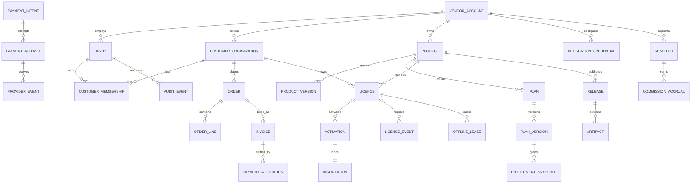

# TLMS domain model

**Status:** Phase 1 conceptual model. Physical schema and migrations are not yet implemented.

## 1. Ownership and deployment boundary

Initial topology is one TLMS installation operated by one software vendor. Each installation has exactly one active `VendorAccount`. Software customers are represented as `CustomerOrganization` records inside that vendor's installation; they are not separate TLMS platform tenants.

Every vendor-owned business record carries `vendor_account_id` (directly or through an immutable parent relationship). Customer-owned resources also carry or inherit `customer_organization_id`. A future hosted SaaS edition requires a separate architecture decision and verified isolation across every storage and execution boundary.

## 2. Core aggregates

| Aggregate | Principal entities | Invariants |
|---|---|---|
| Vendor & identity | VendorAccount, User, Role, Permission, Membership, MFAFactor, Session, ApiToken | One vendor account per initial installation; no privilege from user-supplied role claims |
| Customer | CustomerOrganization, CustomerContact, CustomerMembership, Address, TaxProfile | Customer members are scoped to one organization; ownership changes are audited |
| Product catalogue | Product, ProductVersion, ReleaseChannel, Plan, PlanVersion, EntitlementDefinition, PriceVersion | Published versions are immutable; changes create new versions |
| Commercial | Quote, Order, OrderLine, Subscription, Invoice, InvoiceLine, Coupon, TaxCalculation | Order/price/entitlement snapshots preserve what was purchased |
| Licensing | Licence, LicenceKeyHash, LicenceEntitlementSnapshot, Activation, Installation, DomainBinding, OfflineLease, LicenceEvent | Lifecycle transitions are explicit, atomic and auditable; plaintext key is not persisted |
| Payments & ledger | PaymentIntent, PaymentAttempt, ProviderEvent, PaymentAllocation, Refund, Chargeback, LedgerAccount, LedgerEntry, Reconciliation | Ledger entries are append-only; money uses integer minor/base units |
| Integrations | ProviderDefinition, IntegrationCredential, CredentialVersion, WebhookEndpoint, WebhookDelivery | Secret values encrypted; only metadata returned; provider scope is explicit |
| Resellers | Reseller, ResellerCustomer, Referral, CommissionRuleVersion, CommissionAccrual, Payout | Attribution and commission snapshots are reproducible |
| Releases & updates | Release, Artifact, ArtifactDigest, SBOM, Provenance, TufRole, TufMetadataVersion, SigningKeyReference | Root signing private key remains offline; package metadata is signed and rollback protected |
| Operations | AuditEvent, OutboxMessage, JobRun, Notification, BackupRecord, Incident, SupportTicket | Audit and outbox records are durable; jobs are idempotent and recoverable |

## 3. Relationship map

The diagram is conceptual; exact cardinalities, join entities, and deletion rules must be finalized during schema design.

## 4. Critical entity fields and constraints

### VendorAccount
- `id`, `legal_name`, `display_name`, `status`, `default_currency`, `timezone`, `created_at`.
- One active record in initial single-vendor deployment. Enforce with install-level configuration/bootstrap invariant, not a user-editable tenant switch.

### CustomerOrganization
- `id`, `vendor_account_id`, `external_reference`, `legal_name`, `display_name`, `status`, `billing_email`, `created_at`.
- Unique `(vendor_account_id, external_reference)` where external reference is present.
- Soft deletion only where legally and operationally appropriate; financial/audit references must remain.

### Product / PlanVersion / EntitlementDefinition
- Product has immutable stable identifier, slug, vendor owner, lifecycle status.
- PlanVersion captures versioned commercial terms and entitlement snapshot; published versions are immutable.
- Entitlements are typed: feature boolean, quantity/seat, usage quota, domain/site count, support tier, update access, maintenance window, expiry/term.
- Perpetual licence, maintenance/update entitlement and hosted service entitlement are distinct.

### Licence
- `id`, `vendor_account_id`, `customer_organization_id`, `product_id`, `order_line_id`, `plan_version_id`, `public_reference`, `key_verifier`, `status`, `starts_at`, `expires_at`, `grace_until`, `entitlement_snapshot_id`, `version`.
- Store only a keyed verifier/hash for activation key lookup; display the generated key once.
- State transitions use optimistic versioning and DB transactions.
- Licence ownership changes are explicit transfer events, not mutable foreign keys without history.

### Installation / Activation
- Installation has stable random installation identifier, product, licence, normalized domain, environment class, SDK version, first/last seen and status.
- Domain policy defines apex/subdomain/wildcard/port/path rules and IDNA normalization.
- Activation allocation uses unique constraints and transactions to prevent concurrent over-allocation.
- Clone/restore detection is risk evidence, not sole basis for irreversible revocation.

### Payment and ledger
- Payment intent is a business request; attempts represent provider interactions; provider events are immutable inbound evidence.
- Ledger entries are append-only balanced postings; correction is a compensating entry, never mutation/deletion.
- Store currency and integer amount in minor units (or smallest supported token base units); never floating point.
- Persist provider reference, idempotency key, event ID, signature verification result, settlement and reconciliation status.

### IntegrationCredential
- `id`, `vendor_account_id`, `provider_key`, `environment`, `credential_name`, `encrypted_payload`, `encryption_key_id`, `schema_version`, `version`, `status`, metadata timestamps.
- No secret in audit, logs, response payloads, queue serialization or general settings.
- Credentials are write-only and resolved through a credential service.

### AuditEvent / OutboxMessage
- Audit event captures actor type/ID, action, target type/ID, scope, occurred_at, correlation ID, outcome, reason and redacted metadata.
- No update/delete interface for audit events. Tamper evidence must be defined for the actual DB/backup threat model; append-only application code alone is not a cryptographic guarantee.
- Outbox messages are inserted in the same transaction as domain changes and delivered idempotently.

## 5. Lifecycle state machines

- Licence: pending_payment → pending_activation/active → grace → expired; active may transition to suspended, revoked, transferred/replaced, or reinstated under explicit policies.
- Payment attempt: created → pending → succeeded/failed/cancelled/expired; later refund/chargeback/dispute are separate linked events, not rewriting the original success.
- Credential version: draft → validated → active → disabled/revoked; failed validation remains invalid and cannot displace active version.
- Release: draft → validated → staged → published → deprecated/withdrawn; published metadata is immutable and superseded by a new version.
- Subscription: trialing/active/past_due/paused/cancelled/expired with explicit dunning and entitlement grace policies.

Exact transitions, actors, side effects and idempotency keys must be captured in dedicated state-machine specs before implementation.

## 6. Deletion, retention and money rules

- Financial ledger, provider events, licence lifecycle and security audit history are retained according to legal retention schedule; user personal data is minimized and handled under documented privacy workflows.
- Referential integrity must survive customer account closure; pseudonymize where legally permitted rather than deleting accounting evidence.
- Money uses integer minor units with ISO currency code; token values use integer base units and explicit chain/token contract identifiers.
- FX conversion stores source, rate, quote time, precision and rounding rule.
- No cascading deletion from CustomerOrganization into invoices, ledger entries, licences or audit evidence.
